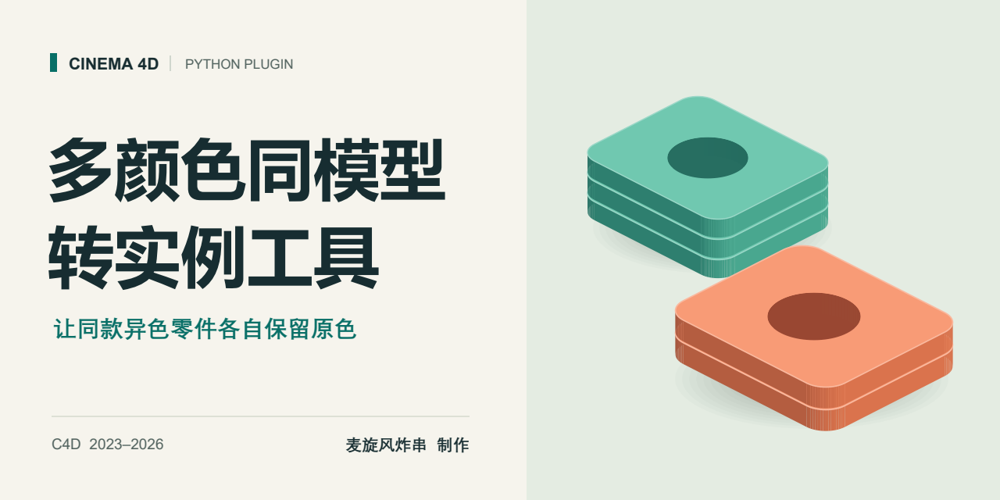
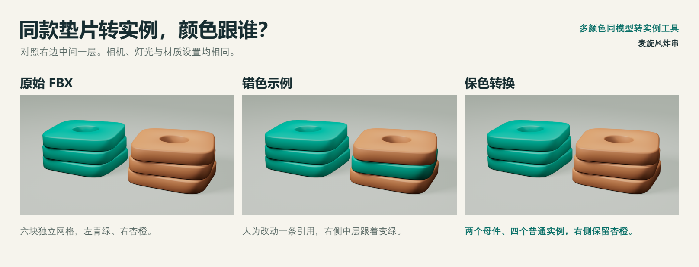
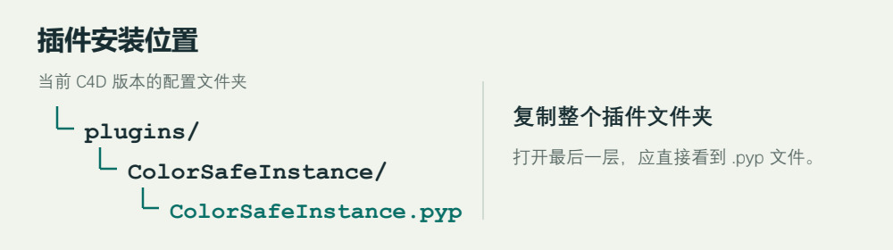
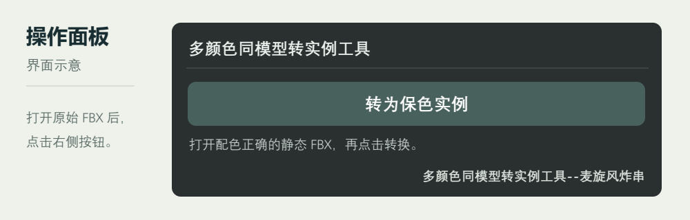

# 多颜色同模型转实例工具

做产品渲染时，同一款零件常常有好几种颜色。这个免费的 Cinema 4D 小插件让同形同材质的重复件共用一个母件，颜色不同的零件各用自己的母件。打开原始 FBX，点一下 **「转为保色实例」**，就能在新工程里得到普通实例。—— 麦旋风炸串

**Cinema 4D 2023–2026 已实测通过。** 测试平台为 Windows。

[获取插件安装包](../../releases) · [图文使用说明（PDF）](docs/使用说明.pdf) · [下载两色垫片示例（FBX）](examples/Two-Color-Washers.fbx)

## 同款零件转实例，颜色跟谁？

看右边中间那块垫片。中图人为把它连到左边的青绿母件，演示一个错误引用就能怎样改变成品颜色。右图来自插件的实际转换。三张图使用相同的相机、灯光和材质设置。

你可以自己复现右图。单独打开[两色垫片 FBX](examples/Two-Color-Washers.fbx)，保留材质并导入为独立可编辑网格。六块垫片形状相同、分成两色。按下转换按钮，面板会显示 **2 个网格，4 个实例**。展开新工程，青绿和杏橙各有一个可编辑母件。

## 安装

1. 解压插件 ZIP，找到 **ColorSafeInstance** 文件夹，里面直接放着 `ColorSafeInstance.pyp`。
2. 在要使用的 C4D 版本中打开 **编辑 → 设置（首选项）→ 打开配置文件夹**。将整个 **ColorSafeInstance** 文件夹复制进 `plugins`。目录里没有 `plugins` 时可自行新建。
3. 重启这个版本的 C4D，按 **Shift+C** 搜索 **多颜色同模型转实例工具**，或从 **扩展** 菜单打开。

## 转换自己的模型

1. **单独打开配色正确的原始 FBX。** 启用材质导入，让零件以独立的可编辑多边形进入场景。换 Octane 材质、布灯或建 Take 可以放在转换之后。
2. **点「转为保色实例」。** 工具处理当前整份模型，第一个匹配的网格成为可编辑母件，其余匹配件生成普通实例。完成后，窗口显示新工程的网格和实例数量。
3. **另存新工程。** 对照原始 FBX 检查同款异色件、印刷方向和摆放位置，再另存为 `.c4d`。如有外部位图，保留贴图路径或选择「保存工程及资源」。

## 使用中常见的问题

| 遇到的情况 | 处理方法 |
|---|---|
| 搜不到插件 | 检查插件是否装到当前 C4D 版本的配置目录。打开 `plugins/ColorSafeInstance/` 后应直接看到 `.pyp`。重启并用中文全名搜索。 |
| 提示「未找到可合并的重复件」 | 先对照两个零件的父级、完整名称和材质球链接。工具还会核对网格、法线、UV、选集和镜像方向。同名但分别创建的材质球也会分开处理。 |
| 结果中有零件被跳过 | 这些零件会原样保留为网格。C4D 的 Python 控制台会列出原因和数量。 |
| 旧实例已经串色 | 重新打开颜色正确的原始 FBX 来转换。原始颜色链接一旦丢失，就需要原模型作依据。 |

本工具面向由空对象和多边形组成、使用原始 FBX 标准材质的静态模型。转换时会复制整份工程，大模型需要预留相应内存。

提交问题时，请附 C4D 完整版本、操作步骤和窗口提示。若涉及配色，附上一组有权公开分享的简单零件即可。

